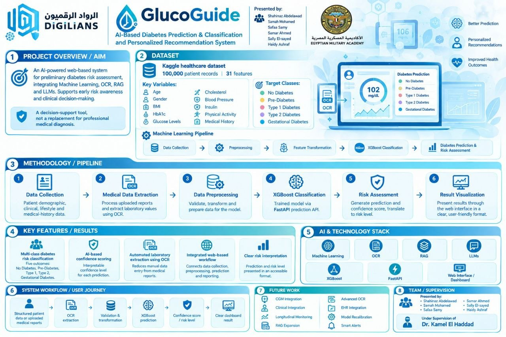

 

  

---

## 👩‍💻 Profile

Science graduate who moved into data through **hands-on training and projects**. Started with **SQL, Python, and BI dashboards** to turn data into business recommendations, then expanded into **machine learning and LLM-based systems**.

Now a **Data Analyst with applied AI experience**, from predictive models to LLM-powered tools.

| 🎓 Education | 📍 Based in | 🧭 Focus |
|:---:|:---:|:---:|
| B.Sc. Special Chemistry *Excellent with Honours* | Egypt | Analytics · ML · LLM Systems |

---

## 🧰 Core Skills

| Area | Tools & Techniques |
|:---|:---|
| 📊 **Analytics & BI** | `SQL` · `Python (Pandas, NumPy)` · `Power BI` · `Tableau` · `Excel` · `EDA` |
| 🤖 **Machine Learning** | `Scikit-learn` · `XGBoost` · `Deep Learning` · `Explainable AI (SHAP)` |
| 🧠 **LLM Systems** | `LangGraph` · `RAG` · `LLM Agents` |

---

## 🚀 Selected Projects

<table>
<tr>
<td width="50%" valign="top">

### 🩺 GlucoGuide
**AI-Based Diabetes Prediction**
*Graduation Project · Digilians*

- Analyzed **100K patient records** and compared **5 classification models**; **XGBoost** achieved **91.6% accuracy** and **95.1% ROC-AUC**
- Applied feature engineering, mutual information, **PCA**, and **SHAP** to evaluate predictive features and explain model outputs
- Developed a **RAG nutrition assistant** using hybrid **BM25 + semantic retrieval** and cross-encoder reranking over a **271-page** clinical reference

`Python` `XGBoost` `SHAP` `RAG`

</td>
<td width="50%" valign="top">

### 🛡️ Verdict
**AI Security Reviewer**
*Training Project · Brightskies*

- Built an **agentic security review system** that detects and triages vulnerabilities using static and dynamic scanners with LLM-based discovery and review
- Owned the **static analysis and AI Discovery** components: integrated **Semgrep, CodeQL, Gitleaks, and Trivy**, and built **LangGraph** workflows to find and classify vulnerabilities beyond scanner rules

`LangGraph` `Semgrep` `CodeQL` `Trivy`

</td>
</tr>
<tr>
<td width="50%" valign="top">

### 🚑 Nabda
**First-Aid AI Assistant**
*Personal Project*

- Built a **bilingual Arabic/English RAG assistant** grounded in a **327-page** first-aid reference, returning cited answers with source and page context
- Implemented hybrid **BM25 + semantic retrieval**, cross-encoder reranking, context filtering, and **confidence-based refusal**

`RAG` `Arabic NLP` `Reranking`

</td>
<td width="50%" valign="top">

### 📊 E-Commerce Sales Analysis Dashboard
*Capstone · DEPI*

- Used **SQL and Python** to clean and analyze product data, focusing on category performance, stock levels, revenue drivers, and analytical questions
- Built a **Tableau dashboard** and translated findings into an actionable stakeholder proposal

`SQL` `Python` `Tableau`

</td>
</tr>
</table>

---

## 🩺 Project Spotlight: GlucoGuide

Click the image to view it in full size

 

---

## 💼 Experience

### 🔹 Applied AI & Data Analytics Trainee
**Digilians – MCIT × Egyptian Military Academy** · *Dec 2025 – Sep 2026*

- Analyzed and transformed real-world datasets across **5 team projects** using Python, Pandas, EDA, and feature engineering
- Built and compared **classification and regression models** using appropriate evaluation metrics to support model selection
- Developed **Power BI dashboards** to communicate KPIs, trends, and analytical findings to mentors and project stakeholders

### 🔹 Data Analyst Intern
**DEPI – Ministry of Communications & IT** · *Oct 2024 – Apr 2025*

- Queried transactional sales data with **SQL** to extract, filter, aggregate, and analyze product and sales performance
- Cleaned and explored datasets with **Python** to identify revenue drivers, product performance patterns, and stock-related insights
- Built **Tableau dashboards** to present e-commerce KPIs and translate analysis into business recommendations

---

## 🎓 Education

| Program | Institution | Period |
|:---|:---|:---:|
| **Professional Diploma in Applied AI & Data Analytics** | Digilians – MCIT × Egyptian Military Academy | 2025 – 2026 |
| **B.Sc. in Special Chemistry** — *Excellent with Honours* | Alexandria University | 2017 – 2021 |

---

## 🤝 Volunteering

📚 **Bibliotheca Alexandrina – Book & Screen** · *2025*
Teaching literacy and basic math to older adults.

---

## 📈 GitHub Activity

---

## ✉️ Let's Connect

Open to **Data Analyst** and **Applied AI** opportunities.

